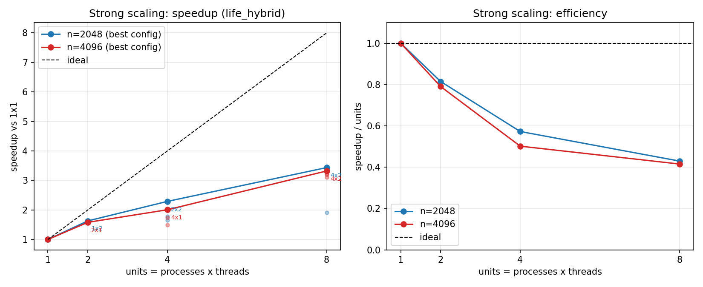
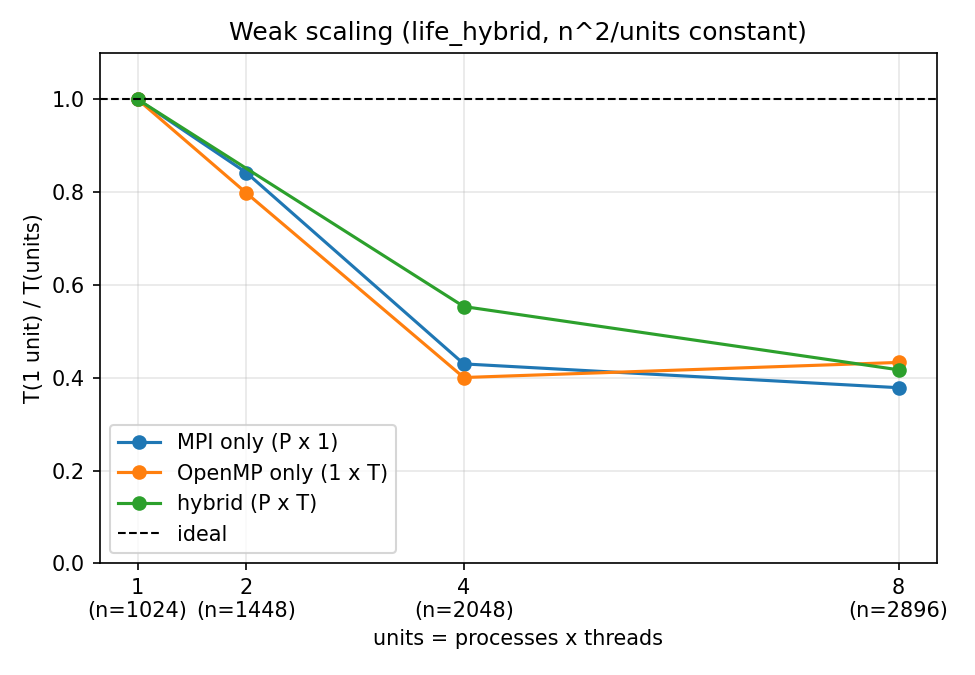
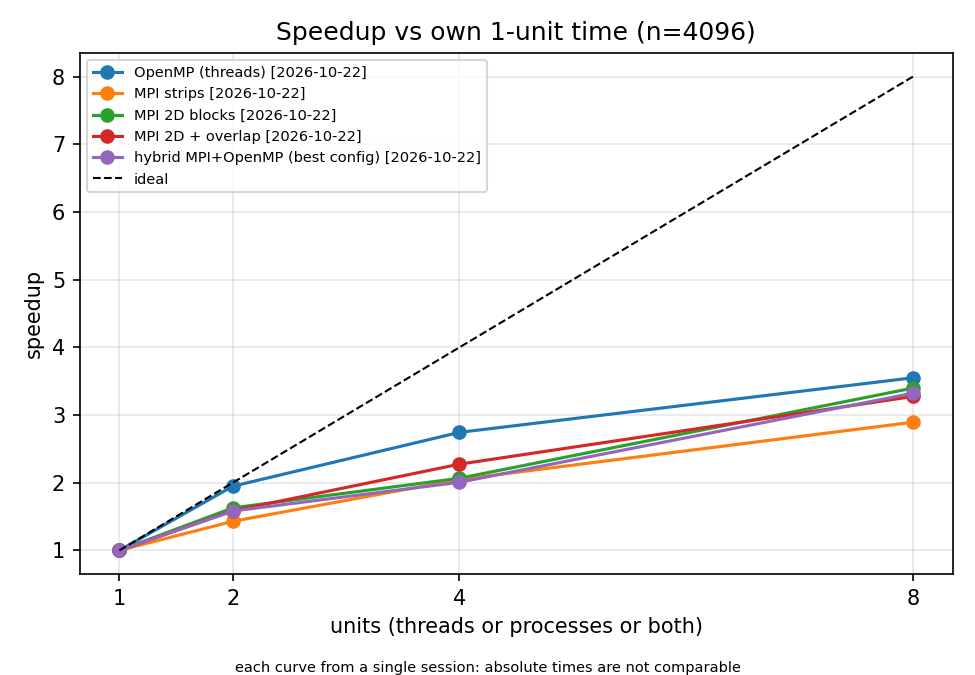
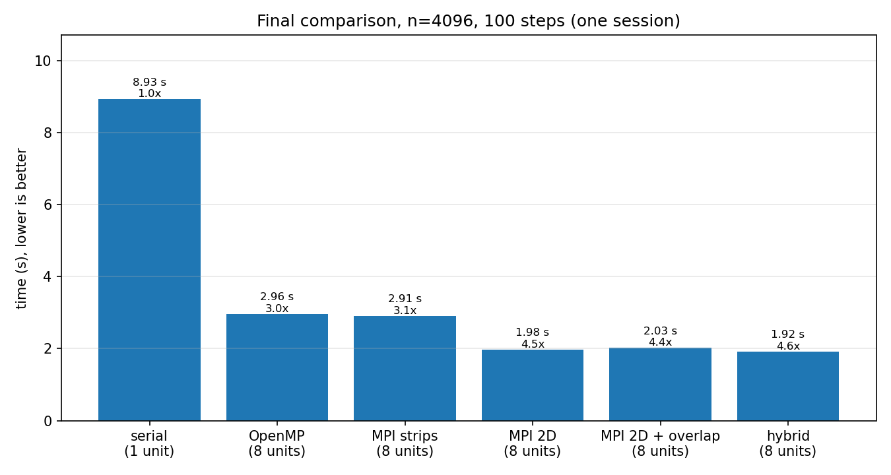
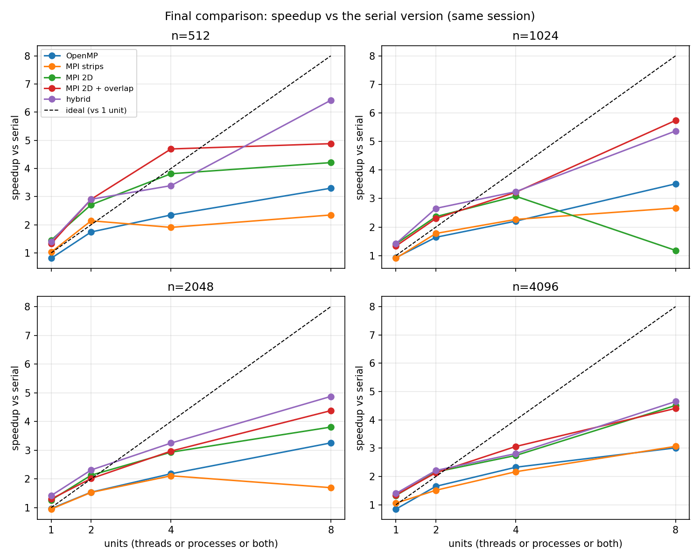

# hpc-life

Progetto didattico di **High Performance Computing (HPC)**: il Game of Life
implementato in versioni sempre più parallele, per imparare passo dopo passo
come si programma e si misura un codice parallelo.

## Obiettivo

Partire da una versione seriale in C e arrivare a una versione ibrida
MPI+OpenMP, misurando a ogni tappa le prestazioni e spiegando i risultati.
Come estensione finale, una versione "falling sand" con rendering grafico.

## Il Game of Life in breve

Griglia 2D di celle vive (1) o morte (0). A ogni passo tutte le celle si
aggiornano in base ai loro 8 vicini:

- una cella viva con 2 o 3 vicini vivi sopravvive, altrimenti muore;
- una cella morta con esattamente 3 vicini vivi nasce.

Ogni cella dipende solo dai vicini: il calcolo è locale e regolare, quindi
ideale da parallelizzare.

## Roadmap

| Tappa | Contenuto | Concetto HPC | Stato |
|---|---|---|---|
| 0 | Setup: Git, gcc, Makefile | Ambiente e strumenti | completata |
| 1 | Versione seriale | Riferimento di correttezza | completata |
| 2 | Misure e ottimizzazione seriale | Cache, profiling | completata |
| 3 | OpenMP | Memoria condivisa, speedup, race condition | completata |
| 4 | MPI a strisce + halo exchange | Memoria distribuita | completata |
| 5 | MPI 2D, overlap calcolo/comunicazione | Topologie cartesiane | completata |
| 6 | Ibrido MPI+OpenMP | Strong/weak scaling | completata |
| 7 | Falling sand + rendering | Estensione "gioco" | in corso |

Ogni tappa completata ha un tag Git (es. `tappa-1-seriale`).

## Requisiti

- Linux/bash, `gcc`, `git`
- OpenMPI (`mpicc`, `mpirun`) dalla tappa 4
- SDL2 e `pkg-config` per il viewer (tappa 7): `sudo apt install libsdl2-dev pkg-config`
- Python 3 con `matplotlib` per i grafici (dalla tappa 2)

Su Ubuntu/Debian:

```bash
sudo apt install build-essential git openmpi-bin libopenmpi-dev
```

## Compilare ed eseguire

```bash
gcc -O2 -o life_serial src/life_serial.c
./life_serial 1024 100      # griglia 1024x1024, 100 passi
```

Output: `n=1024 steps=100 tempo=... s vive=...`

## Verifica della correttezza

Con seed fisso (`srand(0)`, riempimento al 30%), tutte le versioni devono dare
lo stesso numero di celle vive finale a parità di `n` e `steps`.

La versione seriale è **deterministica**: lanciata più volte con gli stessi
`n` e `steps` dà sempre lo stesso numero di celle vive (cambia solo il tempo).
È testata e funzionante, e fa da riferimento per tutte le versioni parallele.

| n | steps | celle vive (riferimento) |
|---|---|---|
| 512 | 100 | 25790 |
| 1024 | 100 | 100277 |
| 2048 | 100 | 397219 |
| 4096 | 100 | 1599426 |
| 1448 | 100 | 201170 |
| 2896 | 100 | 804293 |

Le ultime due dimensioni servono per il weak scaling della Tappa 6.

Il valore di riferimento principale è `./life_serial 1024 100` → **100277**.
Il conteggio è identico in tutte le 5 ripetizioni di ogni `n`.

## Risultati

Tempi della versione seriale (`-O2`, 100 passi, minimo di 5 ripetizioni):

| n | tempo (s) | celle vive |
|---|---|---|
| 512 | 0.153 | 25790 |
| 1024 | 0.624 | 100277 |
| 2048 | 2.617 | 397219 |
| 4096 | 10.914 | 1599426 |

I tempi variano da una ripetizione all'altra e da una sessione all'altra,
per questo si usa il minimo. Le misure si rilanciano con `make bench`
(script `scripts/bench.sh`).

### Ottimizzazione seriale

Eliminati i `%` dal ciclo interno di `step` (sostituiti da confronti con
l'operatore ternario). Tempi in secondi, minimo di 5 ripetizioni; le celle vive
restano identiche al riferimento.

| n | baseline (s) | senza `%` (s) | speedup |
|---|---|---|---|
| 512 | 0.153 | 0.115 | 1.33× |
| 1024 | 0.624 | 0.469 | 1.33× |
| 2048 | 2.617 | 1.956 | 1.34× |
| 4096 | 10.914 | 8.104 | 1.35× |

Baseline e versione ottimizzata sono state misurate in sessioni diverse, ma il
rapporto è stabile su tutte le dimensioni.

### Effetto della cache: ordine dei cicli

Esperimento: stesso `step`, ma con i cicli scambiati (colonne all'esterno, righe
all'interno), cioè leggendo la griglia a salti di `n` byte invece che in
sequenza. Una sola esecuzione per misura, 100 passi, `-O2`. Le celle vive sono
identiche, cambia solo il tempo.

| n | normale (s) | scambiato (s) | rallentamento | ns/cella: normale → scambiato |
|---|---|---|---|---|
| 1024 | 0.472 | 0.655 | 1.4× | 4.5 → 6.2 |
| 2048 | 1.985 | 4.075 | 2.1× | 4.7 → 9.7 |
| 4096 | 8.033 | 49.444 | 6.2× | 4.8 → 29.5 |

Conclusioni:

- La griglia è salvata per righe (*row-major*): le celle di una riga sono
  consecutive in memoria. La RAM trasferisce blocchi da 64 byte (*cache line*),
  quindi con il ciclo interno sulle colonne una lettura porta in cache 64 celle,
  e il prefetcher anticipa i blocchi successivi.
- Con i cicli scambiati ogni lettura cade in una cache line diversa, e le righe
  non restano in cache abbastanza a lungo da essere riusate: il costo per cella
  cresce con `n`, mentre nella versione normale resta circa costante.
- Per `n = 4096` il passo tra una riga e l'altra è 4096 byte (potenza di due),
  probabile causa dell'ulteriore peggioramento.
- Cache del PC di sviluppo (per core): L1d 48 KiB, L2 1.25 MiB, L3 12 MiB
  condivisa. Le tre righe che servono a calcolare una riga (12 KB per
  `n = 4096`) stanno in L1.
- Regola per le tappe successive: l'ordine di accesso alla memoria conta quanto
  il numero di operazioni.

## OpenMP (Tappa 3)

`src/life_omp.c` è la copia di `life_serial.c` con `#pragma omp parallel for`
sul ciclo esterno (righe) di `step`. Compilazione: `make life_omp`
(`-fopenmp`). Thread controllati con `OMP_NUM_THREADS`; misure con
`./scripts/bench.sh ./life_omp <thread>` (minimo di 5 ripetizioni, 100 passi).
Le celle vive coincidono con il riferimento in tutte le configurazioni.

La macchina ha 8 thread hardware su 4 core fisici (hyper-threading).

Tempo (s):

| n | seriale | 1 thread | 2 | 4 | 8 |
|---|---|---|---|---|---|
| 512 | 0.116 | 0.123 | 0.064 | 0.040 | 0.034 |
| 1024 | 0.471 | 0.483 | 0.288 | 0.179 | 0.135 |
| 2048 | 1.943 | 2.133 | 1.139 | 0.755 | 0.629 |
| 4096 | 8.504 | 8.752 | 5.363 | 3.701 | 2.902 |

Speedup (tempo seriale / tempo parallelo):

| n | 2 thread | 4 | 8 |
|---|---|---|---|
| 512 | 1.81× | 2.90× | 3.41× |
| 1024 | 1.64× | 2.63× | 3.49× |
| 2048 | 1.71× | 2.57× | 3.09× |
| 4096 | 1.59× | 2.30× | 2.93× |

Efficienza (speedup / numero di thread):

| n | 2 thread | 4 | 8 |
|---|---|---|---|
| 512 | 90% | 73% | 43% |
| 1024 | 82% | 66% | 44% |
| 2048 | 85% | 64% | 39% |
| 4096 | 79% | 57% | 37% |

Osservazioni:

- Con 1 thread OpenMP è circa uguale al seriale (3-9% più lento): è il costo
  della parte OpenMP.
- Lo speedup massimo è circa 3.5× con 8 thread. L'efficienza cala all'aumentare
  dei thread; oltre i 4 core fisici i thread aggiuntivi aiutano poco.
- Lo speedup peggiora con `n` grande: con griglie piccole i dati stanno nelle
  cache, con `n = 4096` (32 MB) si legge dalla RAM, la cui banda è condivisa
  tra i core. Il problema diventa *memory-bound*.
- Con più thread dei thread hardware (16) il tempo peggiora (misura singola su
  `n = 1024`: 0.151 s contro 0.119 s con 8).

### Race condition: il conteggio delle celle vive

Il conteggio finale `alive += cur[k]` in `main` è un ciclo che si può
parallelizzare, ma `alive` è dichiarata fuori dalla regione parallela, quindi
è **condivisa**: tutti i thread la modificano. (In `step`, invece, le variabili
`up`, `down`, `left`, `right` e `alive` sono dichiarate dentro il ciclo, quindi
sono private di ogni thread e non ci sono conflitti: ogni thread scrive righe
diverse di `next` e legge solo `cur`.)

Esperimento (`n = 1024`, 100 passi, 8 thread, 5 esecuzioni):

| Versione | `vive` | Corretto? |
|---|---|---|
| `#pragma omp parallel for` (senza protezione) | 12275, 12358, 24930, 24639, 12364 | No, cambia a ogni esecuzione |
| `#pragma omp parallel for reduction(+:alive)` | 100277 ×5 | Sì |

Senza protezione gli aggiornamenti si sovrascrivono a vicenda e il risultato
si riduce a circa un ottavo o un quarto del valore corretto, senza alcun errore
o warning: la regola d'oro (stesso numero di celle vive del seriale) serve a
scoprirlo. Con `reduction(+:alive)` ogni thread somma su una copia privata e
le copie vengono combinate alla fine, in modo sicuro.

## MPI a strisce di righe (Tappa 4)

`src/life_mpi.c`: la griglia è divisa in strisce di `n / nprocs` righe, una per
processo (`n` deve essere divisibile per il numero di processi). Ogni processo
tiene le sue righe più due righe di *halo* (sopra e sotto). A ogni passo i
processi si scambiano le righe di confine con due `MPI_Sendrecv` (prima riga
verso `up`, ultima verso `down`; `up` e `down` sono vicini in cerchio, quindi il
toroide verticale è gestito dallo scambio), poi ognuno calcola le sue righe. La
griglia iniziale usa la stessa sequenza di `rand()` del seriale (ogni processo
scarta i numeri delle righe dei processi precedenti). Il totale delle celle vive
si ottiene con `MPI_Reduce`.

Compilazione: `mpicc -O2 -o life_mpi src/life_mpi.c`. Esecuzione:
`mpirun --use-hwthread-cpus -np 4 ./life_mpi 1024 100` (l'opzione serve per
usare gli 8 thread hardware come slot). Misure:
`LAUNCHER="mpirun --use-hwthread-cpus -np 4" ./scripts/bench.sh ./life_mpi`.
Le celle vive coincidono con il riferimento con 1, 2, 4 e 8 processi.

### Confronto seriale / OpenMP / MPI

Tutte le misure nella stessa sessione, 100 passi, minimo di 5 ripetizioni.

Tempo (s):

| n | seriale | OMP 1 | OMP 2 | OMP 4 | OMP 8 | MPI 1 | MPI 2 | MPI 4 | MPI 8 |
|---|---|---|---|---|---|---|---|---|---|
| 512 | 0.120 | 0.112 | 0.062 | 0.049 | 0.034 | 0.115 | 0.052 | 0.036 | 0.027 |
| 1024 | 0.484 | 0.456 | 0.264 | 0.201 | 0.137 | 0.470 | 0.258 | 0.188 | 0.121 |
| 2048 | 1.977 | 1.941 | 1.111 | 0.836 | 0.594 | 1.904 | 1.207 | 0.922 | 0.591 |
| 4096 | 8.266 | 7.920 | 4.952 | 3.458 | 2.408 | 8.001 | 5.014 | 3.734 | 2.640 |

Speedup (tempo seriale / tempo parallelo):

| n | OMP 2 | OMP 4 | OMP 8 | MPI 2 | MPI 4 | MPI 8 |
|---|---|---|---|---|---|---|
| 512 | 1.94× | 2.45× | 3.53× | 2.31× | 3.33× | 4.44× |
| 1024 | 1.83× | 2.41× | 3.53× | 1.88× | 2.57× | 4.00× |
| 2048 | 1.78× | 2.36× | 3.33× | 1.64× | 2.14× | 3.35× |
| 4096 | 1.67× | 2.39× | 3.43× | 1.65× | 2.21× | 3.13× |

Efficienza (speedup / numero di thread o processi):

| n | OMP 2 | OMP 4 | OMP 8 | MPI 2 | MPI 4 | MPI 8 |
|---|---|---|---|---|---|---|
| 512 | 97% | 61% | 44% | 116% | 83% | 56% |
| 1024 | 92% | 60% | 44% | 94% | 64% | 50% |
| 2048 | 89% | 59% | 42% | 82% | 54% | 42% |
| 4096 | 84% | 60% | 43% | 83% | 55% | 39% |

Osservazioni:

- OpenMP ha uno speedup molto regolare al variare di `n` (circa 2.4× a 4 thread,
  3.5× a 8). MPI è migliore per griglie piccole (4.4× a 8 processi per
  `n = 512`) e un po' peggiore per griglie grandi (3.1× contro 3.4× a
  `n = 4096`).
- Il tetto è simile per entrambi (circa 3-4.5×): 4 core fisici con 8 thread
  hardware e memoria condivisa. L'efficienza cala oltre i 4 core.
- Con 1 unità MPI è circa uguale al seriale; la causa del peggioramento di MPI
  per `n` grandi non è stata verificata.
- Le differenze del 5% tra i due modelli sono nell'errore di misura.
- Nei risultati di `bench.sh` per MPI il campo `threads=1` è solo il parametro
  dello script e non riguarda i processi (indicati in `launcher`).

Grafici di speedup ed efficienza: vedi la sezione della Tappa 6.

## MPI 2D con topologia cartesiana (Tappa 5)

Due versioni, entrambe corrette (celle vive uguali al riferimento con 1, 2, 4
e 8 processi):

- `src/life_mpi_2d.c`: blocchi invece di strisce, scambio degli halo
  **bloccante** (`MPI_Sendrecv`);
- `src/life_mpi_2d_overlap.c`: stessa decomposizione, scambio **non bloccante**
  (`MPI_Isend`/`MPI_Irecv`) con sovrapposizione di calcolo e comunicazione.

Compilazione ed esecuzione: `make life_mpi_2d` e `make multi_process_2d`
(`life_mpi_2d_overlap` e `multi_process_2d_overlap` per la seconda). Misure:
`TAPPA=5 PROCS=4 LAUNCHER="mpirun --use-hwthread-cpus -np 4" ./scripts/bench.sh ./life_mpi_2d`,
con i risultati accodati in `results/benchmarks.csv`.

### Decomposizione in blocchi

- `MPI_Dims_create` sceglie la disposizione dei processi (4 → 2×2, 8 → 4×2),
  `MPI_Cart_create` crea il comunicatore con topologia cartesiana e bordi
  periodici (toroide). `MPI_Cart_coords` dà a ogni processo la sua posizione
  `(fila, colonna)`, `MPI_Cart_shift` i vicini sui quattro lati.
- Ogni processo ha un blocco di `n/dims[0]` righe per `n/dims[1]` colonne, più
  un halo di una cella su tutti i lati. In memoria una riga è lunga `stride =
  colonne + 2`, e la cella `(i, j)` è in `cur[i * stride + j]`. `n` deve essere
  divisibile per entrambe le dimensioni.
- La posizione del blocco si ricava dalle coordinate, non dal rank:
  `first_row = coords[0] * righe_locali`, `first_col = coords[1] * colonne_locali`.
- Per avere la stessa griglia iniziale del seriale, ogni processo percorre
  tutta la griglia globale `n × n` estraendo `rand()` per ogni cella e tenendo
  solo quelle del suo blocco. Costa `n²` chiamate a `rand()` per processo,
  fuori dal tempo misurato, e non scala.
- Con il halo completo `step` non ha più i ternari del wraparound: il giro del
  toroide lo fa lo scambio degli halo.

### Scambio degli halo

Versione bloccante, in due fasi: prima le colonne (con un tipo derivato
`MPI_Type_vector`, perché una colonna non è contigua in memoria), poi le
righe intere, halo laterale compreso. In questo modo gli angoli arrivano
"di rimbalzo" dai vicini sopra e sotto. L'ordine è obbligato: invertendolo gli
angoli sarebbero vuoti.

Versione con overlap: otto scambi indipendenti, avviati tutti insieme: 4 lati
(righe di `colonne` celle, colonne con `col_type`) e 4 angoli (una cella
ciascuno, verso i vicini in diagonale trovati con `MPI_Cart_rank`). Siccome
con pochi processi lo stesso vicino può ricevere più messaggi (a 2×2 i quattro
vicini diagonali sono lo stesso processo), ogni messaggio ha un **tag** che
indica la direzione in cui viaggia (`TAG_N`, `TAG_S`, ..., `TAG_SE`). Ciclo di
un passo:

1. avvio di 8 `MPI_Irecv` e 8 `MPI_Isend`;
2. calcolo dell'**interno** del blocco (righe e colonne da 2 a n-1 locali), che
   non usa l'halo, mentre i messaggi sono in viaggio;
3. `MPI_Waitall` sulle 16 richieste;
4. calcolo della **cornice** (prima e ultima riga, prima e ultima colonna);
5. scambio di `cur` e `next`.

`step_region` calcola un rettangolo di celle; si chiama una volta per l'interno
e quattro volte per la cornice.

### Confronto strisce / blocchi 2D (bloccanti)

Stessa sessione, 100 passi, minimo di 5 ripetizioni. Tempo (s), strisce → 2D:

| n | 1 processo | 2 | 4 | 8 |
|---|---|---|---|---|
| 512 | 0.121 → 0.085 | 0.055 → 0.044 | 0.044 → 0.031 | 0.040 → 0.025 |
| 1024 | 0.517 → 0.359 | 0.281 → 0.204 | 0.218 → 0.153 | 0.190 → 0.135 |
| 2048 | 1.976 → 1.458 | 1.259 → 0.813 | 0.969 → 0.655 | 0.951 → 0.624 |
| 4096 | 8.247 → 6.265 | 5.340 → 3.620 | 3.898 → 2.717 | 3.661 → 2.368 |

Speedup di ciascuna versione rispetto a sé stessa con 1 processo:

| n | strisce 2 | strisce 4 | strisce 8 | 2D 2 | 2D 4 | 2D 8 |
|---|---|---|---|---|---|---|
| 2048 | 1.57× | 2.04× | 2.08× | 1.79× | 2.23× | 2.34× |
| 4096 | 1.54× | 2.12× | 2.25× | 1.73× | 2.31× | 2.65× |

Osservazioni:

- La versione 2D è più veloce in assoluto del 25-60% a tutte le dimensioni, ma
  **gran parte del vantaggio c'è già con 1 processo** (1.3-1.4×), dove non
  esiste comunicazione: viene da `step` senza ternari, non dalla topologia.
  Il contributo della decomposizione in blocchi si legge nello speedup rispetto
  a sé stessi: a 8 processi 2.65× contro 2.25× (`n = 4096`), perché un blocco ha
  un perimetro più piccolo di una striscia con lo stesso numero di celle e
  quindi meno dati da scambiare.
- L'efficienza resta bassa (circa 33% a 8 processi per il 2D) per il limite dei
  4 core fisici e della banda di memoria, già visto in Tappa 3 e 4.
- Per isolare davvero l'effetto della topologia andrebbe misurata anche una
  versione a strisce con lo stesso `step` privo di ternari: non è stato fatto.

### Effetto dell'overlap

Stessa sessione (diversa dalla precedente), tempo (s), bloccante → overlap:

| n | 1 processo | 2 | 4 | 8 |
|---|---|---|---|---|
| 512 | 0.088 → 0.096 | 0.076 → 0.048 | 0.032 → 0.026 | 0.038 → 0.286 |
| 1024 | 0.364 → 0.385 | 0.304 → 0.249 | 0.153 → 0.162 | 0.113 → 0.504 |
| 2048 | 1.486 → 1.593 | 1.126 → 1.055 | 0.727 → 0.726 | 1.003 → 1.013 |
| 4096 | 6.392 → 6.757 | 4.443 → 4.420 | 3.129 → 2.939 | 3.153 → 2.793 |

Osservazioni:

- Con 1 processo l'overlap è il 6-9% più lento: è il costo di spezzare `step`
  in interno e cornice, senza comunicazione da nascondere.
- Con 2 e 4 processi le differenze sono piccole e senza andamento chiaro
  (da -18% a +6%, con i tempi corti di `n = 512` poco significativi).
- Con 8 processi le misure non sono affidabili: a `n = 512` e `1024` l'overlap
  risulta fino a 7 volte più lento, ma una prova singola della stessa versione
  a `n = 1024` aveva dato 0.085 s contro i 0.504 s del bench. Variazioni così
  indicano carico sulla macchina durante la misura, non un effetto del
  programma. Le misure non sono state ripetute: per questo non si trae
  nessuna conclusione a 8 processi.
- Su una sola macchina lo scambio è una copia in memoria condivisa e costa molto
  meno del calcolo: nascondere un costo già piccolo dà poco guadagno, che qui
  non supera l'errore di misura. Il vantaggio atteso è su cluster, dove la
  comunicazione passa dalla rete tra nodi.

## Ibrido MPI+OpenMP (Tappa 6)

`src/life_hybrid.c` parte da `life_mpi_2d.c` (blocchi 2D, scambio bloccante;
non dalla versione con overlap, che non ha dato un guadagno misurabile) e
aggiunge OpenMP dentro ogni processo:

- `#pragma omp parallel for` sul ciclo esterno di `step`: i thread di un
  processo si dividono le righe del suo blocco;
- `reduction(+:process_local_alive)` nel conteggio finale;
- il riempimento iniziale resta seriale (`rand()` non è sicura con più
  thread e la sequenza deve coincidere con il seriale);
- `MPI_Init_thread` con `MPI_THREAD_FUNNELED`: i thread lavorano solo dentro
  `step`, le chiamate MPI le fa solo il thread principale. Se MPI non concede
  quel livello, il programma lo segnala su stderr.

Compilazione ed esecuzione: `make life_hybrid`, poi
`make multi_hybrid PROCS=2 THREADS=4` (2 processi, 4 thread ciascuno).
Le celle vive coincidono con il riferimento in tutte le configurazioni.

### La macchina di misura

Intel Core i7-1185G7, 1 socket, 4 core fisici con 2 thread hardware ciascuno
(8 unità), cache come in Tappa 2, esecuzione in WSL. Ha senso scegliere
processi × thread al massimo 8 (oltre c'è sovrasottoscrizione, già vista in
Tappa 3: più thread delle unità hardware peggiorano il tempo). La regola vale
per nodo: su un cluster vale per ogni nodo, non per l'intero sistema.

### Il legame dei processi ai core (`--bind-to`)

Di default `mpirun` con 1 o 2 processi lega ogni processo a un solo core, e
tutti i suoi thread restano chiusi lì. Tempo (s) per `n = 1024`, minimo di 3
esecuzioni:

| processi × thread | default | `--bind-to none` | `--map-by slot:PE=t` |
|---|---|---|---|
| 8 × 1 | 0.112 | 0.138 | 0.127 |
| 4 × 2 | 0.135 | 0.142 | 0.608 |
| 2 × 4 | 0.276 | 0.198 | 0.148 |
| 1 × 8 | 0.457 | 0.143 | 0.147 |

Con 1 × 8 il default è 3 volte più lento (i thread condividono un core).
`--map-by slot:PE=t` è irregolare (4 × 2: 0.608 s, valore non spiegato). **Tutte
le misure ibride usano `mpirun --use-hwthread-cpus --bind-to none`.**

### Strong scaling

Problema fisso, unità (processi × thread) crescenti. Tempo minimo di 5
ripetizioni, 100 passi, sessione unica; speedup rispetto a 1 × 1.

| unità | config | n=2048 (s) | speedup | eff. | n=4096 (s) | speedup | eff. |
|---|---|---|---|---|---|---|---|
| 1 | 1×1 | 1.424 | 1.00× | 100% | 6.081 | 1.00× | 100% |
| 2 | 2×1 | 0.787 | 1.81× | 90% | 3.994 | 1.52× | 76% |
| 2 | 1×2 | 0.892 | 1.60× | 80% | 3.944 | 1.54× | 77% |
| 4 | 4×1 | 0.672 | 2.12× | 53% | 2.834 | 2.15× | 54% |
| 4 | 2×2 | 0.625 | 2.28× | 57% | 2.755 | 2.21× | 55% |
| 4 | 1×4 | 0.596 | 2.39× | 60% | 2.773 | 2.19× | 55% |
| 8 | 8×1 | 0.449 | 3.17× | 40% | 1.992 | 3.05× | 38% |
| 8 | 4×2 | 0.441 | 3.23× | 40% | 1.922 | 3.16× | 40% |
| 8 | 2×4 | 0.408 | 3.49× | 44% | 1.886 | 3.22× | 40% |
| 8 | 1×8 | 0.369 | 3.86× | 48% | 1.872 | 3.25× | 41% |

(I dati per `n = 512` e `1024` sono in `results/benchmarks.csv`.)

### Weak scaling

Celle per unità costanti: `n = 1024 · √unità`, quindi `n` = 1024, 1448, 2048,
2896 per 1, 2, 4, 8 unità. Il tempo ideale resta costante; l'efficienza è
`T(1 unità) / T(N unità)`. I valori di riferimento delle celle vive per
`n = 1448` e `2896` sono nella tabella di correttezza.

| unità | n | config | tempo (s) | efficienza |
|---|---|---|---|---|
| 1 | 1024 | 1×1 | 0.379 | 100% |
| 2 | 1448 | 2×1 | 0.418 | 91% |
| 2 | 1448 | 1×2 | 0.441 | 86% |
| 4 | 2048 | 4×1 | 0.671 | 56% |
| 4 | 2048 | 2×2 | 0.607 | 62% |
| 4 | 2048 | 1×4 | 0.591 | 64% |
| 8 | 2896 | 8×1 | 0.930 | 41% |
| 8 | 2896 | 4×2 | 0.881 | 43% |
| 8 | 2896 | 2×4 | 0.844 | 45% |
| 8 | 2896 | 1×8 | 0.813 | 47% |

### Grafici

`python3 scripts/plot_results.py` legge `results/benchmarks.csv` e scrive in
`results/` tre immagini (richiede matplotlib: `sudo apt install python3-matplotlib`):

- `strong_scaling.png`: speedup ed efficienza dello strong scaling;
- `weak_scaling.png`: efficienza del weak scaling per famiglia di configurazioni;
- `versions_speedup.png`: speedup di ogni versione (OpenMP, MPI strisce, MPI 2D,
  2D con overlap, ibrido) rispetto al proprio tempo con 1 unità, a `n = 4096`.
  Ogni curva usa una sola sessione, quindi i tempi assoluti delle versioni non
  si confrontano. Siccome ogni curva è relativa al proprio tempo con 1 unità,
  il grafico non mostra il vantaggio assoluto di `step` senza ternari (circa
  1.3× del 2D sulle strisce già con 1 processo).







### Osservazioni

- A 8 unità la differenza tra le combinazioni è piccola: per `n = 4096` tutte
  entro il 6% (da 1.872 s con 1×8 a 1.992 s con 8×1), per `n = 2048` fino al 22%
  (0.369 s contro 0.449 s). La tendenza è che con più thread e meno processi il
  tempo cala leggermente, ma l'MPI puro non perde in modo netto.
- Lo speedup massimo con 8 unità è 3.3–3.9×, in linea con OpenMP puro (3.5×) e
  MPI puro (3.1–4.4×) di Tappa 3 e 4. L'efficienza cala sopra i 4 core fisici
  (il secondo thread hardware di un core aggiunge poco) e probabilmente per la
  banda di memoria condivisa: è un'ipotesi, non verificata.
- Nel weak scaling il tempo non resta costante: a 8 unità è 2.1–2.5 volte il
  tempo a 1 unità. Con 2 unità l'efficienza è buona (86–91%), poi cala.
- Il vantaggio atteso dell'ibrido, cioè meno processi e quindi meno messaggi
  sulla rete tra nodi, qui non può emergere: la macchina è un solo nodo e la
  comunicazione è una copia in memoria. Il risultato si legge come "l'ibrido
  non costa nulla e non guadagna su un nodo", non come "l'ibrido non serve".
- Limiti delle misure: sessione unica per ogni tabella; i tempi di sessioni
  diverse non si confrontano (la macchina varia di ±10% e, dopo queste
  misure, è stata osservata una fase 3–5 volte più lenta per cause esterne a
  WSL: anche il seriale impiegava 1.2–2.3 s invece di 0.47 s per `n = 1024`).
  Le misure del CSV sono precedenti a quella fase.

## Confronto finale

Tutte le versioni misurate **in una sola sessione** (`make final`, cioè
`scripts/final_comparison.sh`): macchina ferma (load average 0.01 all'inizio),
100 passi, minimo di 5 ripetizioni, stesso lancio `mpirun --use-hwthread-cpus
--bind-to none` per ogni versione MPI. Le righe sono nel CSV con
`tappa = final`. Le celle vive coincidono con il riferimento in tutte le 108
misure. Grafici e tabelle: `make plots`.





Tempo in secondi (speedup rispetto al seriale della stessa sessione,
configurazione processi×thread). Per ogni colonna "unità" è riportata la
configurazione più veloce con quel numero di unità.

**n = 4096** (seriale: 8.925 s)

| versione | 1 unità | 2 | 4 | 8 |
|---|---|---|---|---|
| OpenMP | 10.527 (0.85×) | 5.404 (1.65×) | 3.836 (2.33×) | 2.965 (3.01×) |
| MPI strisce | 8.431 (1.06×) | 5.898 (1.51×) | 4.117 (2.17×) | 2.913 (3.06×) |
| MPI 2D | 6.725 (1.33×) | 4.131 (2.16×) | 3.255 (2.74×) | 1.979 (4.51×) |
| MPI 2D + overlap | 6.634 (1.35×) | 4.185 (2.13×) | 2.917 (3.06×) | 2.026 (4.41×) |
| ibrido | 6.378 (1.40×) | 4.034 (2.21×) | 3.178 (2.81×) | 1.920 (4.65×) (4×2) |

**n = 2048** (seriale: 2.066 s)

| versione | 1 unità | 2 | 4 | 8 |
|---|---|---|---|---|
| OpenMP | 2.135 (0.97×) | 1.344 (1.54×) | 0.948 (2.18×) | 0.635 (3.25×) |
| MPI strisce | 2.178 (0.95×) | 1.351 (1.53×) | 0.980 (2.11×) | 1.219 (1.69×) ⚠ |
| MPI 2D | 1.635 (1.26×) | 0.971 (2.13×) | 0.705 (2.93×) | 0.543 (3.80×) |
| MPI 2D + overlap | 1.589 (1.30×) | 1.027 (2.01×) | 0.696 (2.97×) | 0.472 (4.38×) |
| ibrido | 1.457 (1.42×) | 0.894 (2.31×) | 0.636 (3.25×) | 0.424 (4.87×) (4×2) |

**n = 1024** (seriale: 0.499 s)

| versione | 1 unità | 2 | 4 | 8 |
|---|---|---|---|---|
| OpenMP | 0.538 (0.93×) | 0.304 (1.64×) | 0.226 (2.21×) | 0.142 (3.51×) |
| MPI strisce | 0.551 (0.91×) | 0.281 (1.78×) | 0.220 (2.27×) | 0.187 (2.67×) |
| MPI 2D | 0.354 (1.41×) | 0.211 (2.36×) | 0.162 (3.08×) | 0.422 (1.18×) ⚠ |
| MPI 2D + overlap | 0.374 (1.33×) | 0.217 (2.30×) | 0.155 (3.22×) | 0.087 (5.74×) |
| ibrido | 0.352 (1.42×) | 0.188 (2.65×) | 0.154 (3.24×) | 0.093 (5.37×) (1×8) |

**n = 512** (seriale: 0.122 s)

| versione | 1 unità | 2 | 4 | 8 |
|---|---|---|---|---|
| OpenMP | 0.151 (0.81×) | 0.070 (1.74×) | 0.052 (2.35×) | 0.037 (3.30×) |
| MPI strisce | 0.119 (1.03×) | 0.057 (2.14×) | 0.064 (1.91×) ⚠ | 0.052 (2.35×) |
| MPI 2D | 0.084 (1.45×) | 0.045 (2.71×) | 0.032 (3.81×) | 0.029 (4.21×) |
| MPI 2D + overlap | 0.092 (1.33×) | 0.042 (2.90×) | 0.026 (4.69×) | 0.025 (4.88×) |
| ibrido | 0.087 (1.40×) | 0.042 (2.90×) | 0.036 (3.39×) | 0.019 (6.42×) (2×4) |

I valori contrassegnati con ⚠ sono anomalie: sono molto peggiori dei valori
vicini e di quelli delle sessioni precedenti (per esempio MPI 2D con 8 processi
a `n = 1024`: 0.422 s, contro 0.087 s dell'overlap e circa 0.11-0.14 s delle
misure di Tappa 5). Compaiono solo con 8 processi MPI puri (o 4 a `n = 512`),
e il minimo di 5 ripetizioni non le elimina. Probabile causa, non verificata:
disturbo dello scheduler sulla macchina con 8 processi che occupano tutti i
thread hardware. Non vanno lette come proprietà delle versioni.

### Cosa ha portato ogni passo (n = 4096, 8 unità)

| passo | tempo (s) | speedup vs seriale | nota |
|---|---|---|---|
| seriale | 8.925 | 1.0× | riferimento |
| OpenMP, 8 thread | 2.965 | 3.0× | memoria condivisa |
| MPI a strisce, 8 processi | 2.913 | 3.1× | uguale a OpenMP |
| MPI 2D, 8 processi | 1.979 | 4.5× | +47% rispetto alle strisce |
| MPI 2D con overlap | 2.026 | 4.4× | nessun guadagno (−2%, rumore) |
| ibrido (4×2) | 1.920 | 4.65× | +3% rispetto al 2D, rumore |

- Il salto da MPI a strisce a MPI 2D (1.47× a 8 unità) ha due cause:
  `step` senza ternari, che da solo dà 1.25× già con 1 processo (8.431 s → 6.725 s),
  e i blocchi, che riducono il bordo da scambiare e danno circa 1.17× in più.
- Una parte dello speedup totale non viene dal parallelismo: con 1 unità
  l'ibrido è già 1.40× più veloce del seriale (6.378 s contro 8.925 s) grazie a
  `step` senza ternari (il seriale li ha, per il wraparound) e alla struttura a
  blocchi con halo. Lo
  speedup puro del parallelismo dell'ibrido è 6.378 / 1.920 = 3.3×, e
  1.40 × 3.3 = 4.65×.
- OpenMP e MPI a strisce hanno lo stesso risultato (circa 3×) perché sono limitati
  dallo stesso collo di bottiglia: 4 core fisici e banda di memoria condivisa.
- Sovrapporre calcolo e comunicazione (overlap) e usare thread dentro i
  processi (ibrido) non migliorano in modo misurabile su un solo nodo: la
  comunicazione è già una copia in memoria. Sono tecniche pensate per
  cluster; qui il guadagno è dentro il rumore (±5-10%).
- Con griglie piccole (`n = 512`, 1024) l'ibrido e l'overlap arrivano a 4.9-6.4×
  con 8 unità, più che a `n = 4096`. Ipotesi, non verificata: a `n = 512` il
  blocco di ogni processo sta nella cache privata del core.
- Il tempo di una stessa configurazione varia di circa ±10% tra misure (per
  esempio OpenMP con 1 thread risulta più lento del seriale di 15% a
  `n = 4096`): differenze sotto il 10% non sono significative.

## Viewer: il Game of Life in una finestra (Tappa 7, parte 1)

Finora le versioni stampavano solo il numero di celle vive. In `viewer/` c'è un
visualizzatore con SDL2, separato da `src/` perché ha uno scopo diverso (non si
usa per misurare: la pausa tra le immagini falserebbe i tempi).

```
viewer/viewer.h      interfaccia del modulo di rendering (dichiarazioni)
viewer/viewer.c      implementazione con SDL2
viewer/life_view.c   programma: Game of Life seriale + finestra
```

Il modulo di rendering non conosce il Game of Life: riceve una griglia di byte
(riga per riga, 0 = cella vuota, altro = cella disegnata) e la disegna. Lo
stesso modulo servirà ai prossimi viewer (falling sand, versione ibrida).
Interfaccia, in `viewer.h`:

| funzione | cosa fa |
|---|---|
| `viewer_open(title, grid_w, grid_h, cell_px)` | crea finestra e renderer; ritorna un puntatore (o `NULL`) |
| `viewer_poll(v)` | legge gli eventi; ritorna 0 se l'utente chiude la finestra o preme ESC |
| `viewer_draw(v, grid)` | disegna la griglia e aspetta `delay_ms` |
| `viewer_set_delay(v, delay_ms)` | pausa tra le immagini (default 16 ms, circa 60 immagini al secondo) |
| `viewer_close(v)` | libera finestra e risorse |

`Viewer` è un *tipo opaco*: l'header dichiara solo che esiste (`typedef struct
Viewer Viewer;`), i campi sono definiti in `viewer.c`.

`life_view.c` è una copia di `life_serial.c` con `step` e il riempimento
iniziale uguali (stesso seed, 30% di celle vive); il `main` è diverso: apre la
finestra, esegue `steps` passi disegnando ogni generazione e poi tiene sullo
schermo l'ultima immagine finché non si preme ESC. `step` esiste quindi in
più copie nel progetto (una per versione), come scelta consapevole: un file
condiviso avrebbe richiesto di modificare il riferimento di correttezza.

Compilazione e uso: `make life_view`, poi
`./life_view [n] [steps] [cell_px] [delay_ms]`, con default 256, 500, 3 e 16.
Esempio: `./life_view 64 300 12 150` (griglia 64, celle da 12 pixel, circa 7
immagini al secondo, "al rallentatore"). La finestra misura `n × cell_px`
pixel per lato, quindi `n × cell_px` va tenuto sotto circa 900 per stare nello
schermo. La finestra funziona in WSL grazie a WSLg.

Limite noto: `viewer_draw` fa una chiamata `SDL_RenderFillRect` per ogni cella
viva, quindi con griglie grandi (per esempio 1024 con 1 pixel per cella) il
disegno diventa più lento del calcolo. Per quei casi servirebbe una
`SDL_Texture` aggiornata in un colpo solo.

## Viewer ibrido MPI+OpenMP (Tappa 7, parte 2)

`viewer/life_view_hybrid.c` mostra in una finestra il Game of Life calcolato
dalla versione ibrida (blocchi 2D, `step` con OpenMP). Usa lo stesso modulo
`viewer.h`/`viewer.c`. Compilazione: `make life_view_hybrid`; esecuzione:
`make run_view_hybrid PROCS=4 THREADS=2 VIEW_ARGS="128 400 6 40"`
(argomenti: `n steps cell_px delay_ms`, più un quinto `hold`: con 0 il
programma esce da solo a fine passi).

Come si fa a mostrare una griglia distribuita:

- **La finestra la ha solo il rank 0.** Gli altri processi non toccano SDL.
- **Raccolta a ogni immagine:** ogni processo copia le sue celle (senza halo)
  in un buffer contiguo; `MPI_Gather` li porta nel rank 0, che li rimette al
  posto giusto in una griglia `n × n` (con `MPI_Cart_coords` sa dove sta il
  blocco di ogni processo) e la disegna.
- **Uscita sincronizzata:** il rank 0 legge la tastiera (`viewer_poll`) e a ogni
  immagine manda l'esito a tutti con `MPI_Bcast`. Senza, il rank 0 uscirebbe e
  gli altri resterebbero bloccati in attesa dei suoi messaggi.
- Se `viewer_open` fallisce, il rank 0 lo comunica con un `MPI_Bcast` e tutti
  escono insieme. I parametri (`n` tra 2 e 4096 e divisibile per le dimensioni
  della griglia di processi) sono controllati da **tutti** i processi.
- La griglia raccolta coincide con il riferimento: le celle vive dopo 100 passi
  sono 100277 a `n = 1024` e 25790 a `n = 512`, con 1×1, 2×2, 4×2, 8×1 e 1×8
  (processi × thread).

### Dove va il tempo di ogni immagine

`scripts/view_bench.sh` (200 passi, nessuna pausa, mediana di 3 esecuzioni)
misura per ogni immagine il tempo di calcolo (scambio degli halo e `step`), di
raccolta (`MPI_Gather` e montaggio) e di disegno. Le righe sono in
`results/view_benchmarks.csv` (colonna `driver`). Le misure qui sotto usano il
driver video `dummy` di SDL (`SDL_VIDEODRIVER=dummy`): nessuna finestra vera, e
il disegno è quindi quello in memoria; il lancio con finestre vere interrompeva
la sessione di WSL dopo qualche minuto, e il costo di mostrare la finestra al
desktop è più alto (vedi sotto). Griglia con celle da 1 pixel. Tempi in
millisecondi per immagine: calcolo / raccolta / disegno (totale).

| config (processi×thread) | n = 256 | n = 512 | n = 1024 |
|---|---|---|---|
| 1×1 | 0.20 / 0.01 / 0.53 (0.74) | 0.90 / 0.04 / 1.93 (2.87) | 4.08 / 0.33 / 9.05 (13.5) |
| 4×1 | 0.08 / 0.05 / 0.64 (0.76) | 0.28 / 0.14 / 2.42 (2.84) | 1.46 / 0.78 / 12.07 (14.3) |
| 2×2 | 0.08 / 0.03 / 0.57 (0.67) | 0.34 / 0.13 / 2.45 (2.92) | 1.46 / 0.51 / 10.41 (12.4) |
| 1×4 | 0.08 / 0.01 / 0.54 (0.63) | 0.43 / 0.07 / 2.53 (3.03) | 1.54 / 0.33 / 9.94 (11.8) |
| 8×1 | 0.40 / 0.22 / 1.15 (1.77) | 1.71 / 1.56 / 5.76 (9.04) | 2.46 / 2.41 / 21.54 (26.4) |
| 4×2 | 0.17 / 0.24 / 0.79 (1.19) | 1.35 / 0.46 / 4.51 (6.32) | 1.42 / 1.29 / 16.02 (18.7) |
| 2×4 | 0.15 / 0.08 / 0.78 (1.01) | 0.59 / 0.39 / 3.41 (4.38) | 1.46 / 0.79 / 13.62 (15.9) |
| 1×8 | 0.13 / 0.01 / 0.68 (0.82) | 1.07 / 0.09 / 3.15 (4.30) | 1.64 / 0.40 / 12.37 (14.4) |

Osservazioni:

- **Il disegno domina:** a `n = 1024` è il 67% del tempo di un'immagine con
  1×1 e l'84-90% con le altre configurazioni. Il calcolo, che è la parte
  parallelizzata, pesa il 9-13% (30% con 1×1).
- **Il calcolo scala ma l'immagine no:** a `n = 1024` il calcolo passa da 4.08
  ms (1×1) a 1.42-1.64 ms (circa 2.5-2.9×), ma il tempo totale di un'immagine
  migliora al massimo di 1.14× (1×4: 11.8 ms contro 13.5 ms). Per `n = 256` e
  `512` nessuna configurazione è meglio di 1×1 in modo significativo.
- **Con più processi l'immagine peggiora:** con 8×1 il tempo totale è il doppio
  di 1×1 (26.4 ms contro 13.5 ms a `n = 1024`), perché la raccolta costa 2.4 ms
  (contro 0.3 ms) e anche il disegno rallenta (21.5 ms contro 9.0 ms). Ipotesi,
  non verificata: i processi che aspettano nelle chiamate MPI (attesa attiva)
  occupano i thread hardware e rubano tempo al rank 0, che deve disegnare.
- **La scelta migliore per il viewer è pochi processi e molti thread** (1×4,
  2×2): meno raccolta e nessun costo di MPI, lo stesso calcolo.
- **Finestra vera contro driver `dummy`:** le dieci righe misurate con la
  finestra vera (`driver = real`, tutto `n = 256` e le prime due configurazioni
  di `n = 512`, poi la sessione WSL si è interrotta) hanno un disegno 3-6
  volte più lento (per esempio 1×1 a `n = 256`: 3.3 ms contro 0.53 ms; 1×1 a
  `n = 512`: 9.1 ms contro 1.9 ms). Con la finestra vera il disegno pesa ancora
  di più.
- Conclusione generale: se la parte non parallelizzabile (qui, raccolta e
  disegno nel rank 0) è grande, accelerare il calcolo con più risorse dà un
  guadagno molto piccolo (legge di Amdahl).

## Struttura

```
src/        codice C
viewer/     visualizzatore SDL2 (viewer.h, viewer.c, life_view.c, life_view_hybrid.c)
scripts/    script (bench.sh, final_comparison.sh, view_bench.sh, plot_results.py)
results/    misure (benchmarks.csv, view_benchmarks.csv) e grafici (png)
```

`results/benchmarks.csv` raccoglie tutte le misure
(`data,tappa,versione,n,processi,thread,tempo_min,vive`), prodotte da
`scripts/bench.sh` con le variabili `TAPPA` e `PROCS`. Misure di sessioni
diverse non vanno confrontate tra loro (il tempo varia tra le sessioni):
nel README sono sempre messe a confronto quelle della stessa sessione.

## Risorse

- LLNL HPC Tutorials (OpenMP, MPI)
- mpitutorial.com
- Hager, Wellein: *Introduction to High Performance Computing for Scientists and Engineers*
